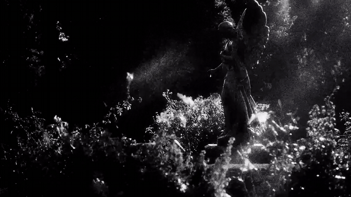
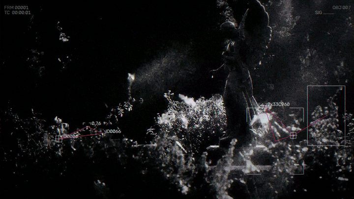

<div align="center">



<br/><br/>

### Turn any clip into a beat-synced slide into cyberpsychosis.

Time slows on the drop. Neon ghosts trail everything that moves.<br/>
A tracking HUD locks on. Then reality snaps back.

<sub>PURE PYTHON &nbsp;·&nbsp; RUNS LOCALLY &nbsp;·&nbsp; NO AFTER EFFECTS</sub>

</div>

<br/>


## `BEFORE`



## `AFTER` &nbsp;<sub>// REDLINE ENGAGED</sub>



<br/>


## `WHAT IT DOES`

| | |
|---|---|
| **Time dilation** | On big hits the video drops to 0.3× speed while the music keeps going, then snaps back |
| **Afterimage trails** | Moving things leave color-shifted ghost copies behind them |
| **Neon flashes** | Every beat fires a flash in the next color of the palette |
| **Tracking HUD** | Boxes, crosshairs and numbers lock onto the footage and flicker with the beat |
| **Graphic slams** | Short duotone frames and bold word cards cut in on some hits |
| **Glitch layer** | RGB split, glitch slices, edge glow, scanlines and grain |

All of it is timed to the music. Beats are detected automatically from the clip's audio.

<br/>


## `SETUP`

```bash
git clone https://github.com/Hrishikesh-Gavai/REDLINE.git
cd REDLINE

python -m venv .venv
.venv\Scripts\activate            # Windows
# source .venv/bin/activate       # macOS / Linux

pip install -r requirements.txt
```

> [!NOTE]
> ffmpeg comes bundled with `imageio-ffmpeg`, so there's nothing else to install.

<br/>

## `RUN`

```bash
python main.py input/clip.mp4
```

Your video is saved as `output/clip_go_redline.mp4`, with the original audio.

```bash
python main.py input/clip.mp4 --preview                    # also save stills to output/preview/
python main.py input/clip.mp4 --set video.duration=10      # quick 10-second test
python make_test_clip.py                                   # no footage? make a test clip
```

<br/>

## `TWEAK`

Change any setting in `config.yaml`, or straight from the command line:

```bash
--set seed=42                            # a different random edit
--set edit.dilation.cooldown=3           # more slow-mo moments
--set edit.dilation.speed=0.2            # slower slow-mo
--set overdrive.trails.echoes=10         # longer trails
--set hud.show_fraction=0.3              # more boxes
--set "palette=['#FF3D7F','#FFFFFF']"    # your own colors
--set video.max_width=720                # faster render
```

| Want | Change |
|---|---|
| Calmer | raise `audio.min_hit_gap`, turn off `glitch_slices` |
| More intense | lower `dilation.cooldown`, raise `neon_flash.strength` |
| Longer trails | raise `trails.echoes` and `trails.spacing` |
| Cleaner trails | raise `trails.threshold` |
| Boxes on people/objects | `pip install ultralytics`, then `--set tracking.yolo.enabled=true` |

> [!TIP]
> Footage with movement works best: someone turning, a hand swipe, something passing close to the camera.

<br/>


## `PROJECT`

```
REDLINE/
├── main.py              run this
├── config.yaml          all settings
├── make_test_clip.py    makes a test clip
├── make_demo.py         makes the before/after GIFs
├── requirements.txt
├── src/
│   ├── video_io.py      reading and writing video
│   ├── audio.py         beat detection
│   ├── editor.py        slow-mo, stutters, freezes
│   ├── overdrive.py     trails, glow, color grade
│   ├── palette.py       colors
│   ├── tracking.py      what the boxes follow
│   ├── hud.py           the boxes and readouts
│   ├── effects.py       flashes, glitches, finishing
│   └── pipeline.py      puts it all together
├── assets/              banner, dividers, demo GIFs, fonts
├── input/               your clips
└── output/              your renders
```

<br/>

## `ADD YOUR OWN EFFECT`

```python
# src/effects.py
def my_effect(f, ctx, amount=5, **_):
    if ctx.dilate > 0.5:                 # react to slow-mo, beats (ctx.is_hit), etc.
        f = cv2.GaussianBlur(f, (0, 0), amount)
    return f

REGISTRY["my_effect"] = my_effect
```

Then add it to the `effects:` list in `config.yaml`:

```yaml
  - name: my_effect
    enabled: true
    amount: 8
```

<br/>

## `MAKE THE DEMO GIFS`

```bash
python main.py input/clip.mp4
python make_demo.py --start 0 --seconds 6
```

Pick a `--start` that includes a slow-mo moment. If a GIF is over 10 MB, add `--width 560`.

<br/>


